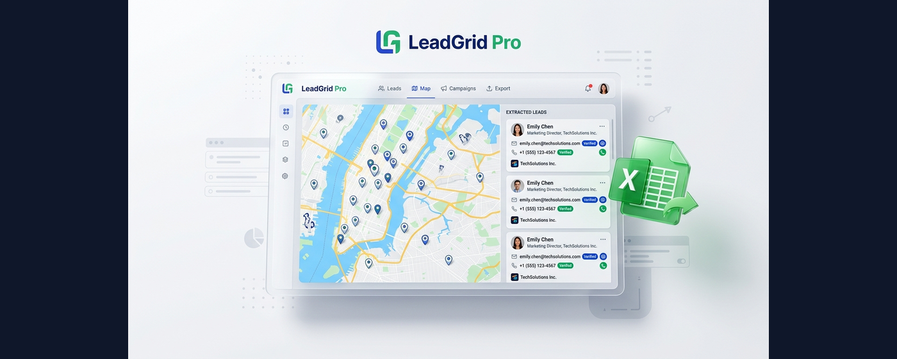
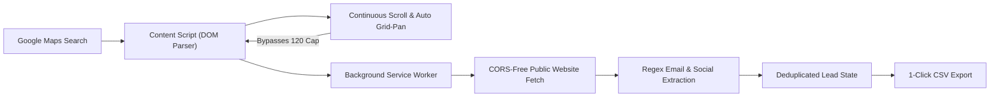

# 🗺️ LeadGrid Pro: Google Maps B2B Lead Scraper & Contact Enricher

[](https://opensource.org/licenses/MIT)
[](https://developer.chrome.com/docs/extensions/mv3/intro/)
[](https://whop.com/aleemice/leadgrid-pro)
[](https://aleemice.gumroad.com/l/leadgrid-pro)
[](https://microsoftedge.microsoft.com/addons)
[](https://chrome.google.com/webstore)

> **Extract unlimited B2B leads from Google Maps with automatic grid-panning, verified phone numbers, and direct website email enrichment. 100% Client-Side. $0 API Costs.**



---

## ⚡ The Problem: Why Traditional Scrapers Fall Short

1. **Google's 120-Result Viewport Cap:** Google Maps arbitrarily caps search results to ~120 businesses per viewport. Even if a city has 2,000 plumbers or dentists, standard scrapers stop once the scrollbar hits the bottom.
2. **Expensive Recurring API Bills:** Cloud scraping services (Outscraper, Apify, PhantomBuster) charge per-row credits that quickly add up to $50–$200/month, plus proxy overhead.
3. **Missing Contact Emails:** Google Maps lists phone numbers and websites, but rarely direct contact emails. To run cold outbound, marketers must pay for another enrichment service.

---

## 🚀 The Solution: LeadGrid Pro

LeadGrid Pro is an autonomous, lightweight **Manifest V3 browser extension** designed for growth marketers, lead generation agencies, and cold emailers.

- 🗺️ **Canvas Auto-Panning (Bypasses the 120-Result Cap):** Automatically pans the Google Maps canvas quadrant-by-quadrant and triggers *"Search this area"*, seamlessly extracting 500–1,000+ businesses across entire metropolitan areas.
- ✉️ **Zero-Cost Client-Side Email & Social Enrichment:** Directly crawls company homepages, `/contact`, and `/about` pages in the background using your browser's CORS-free service worker. Extracts verified emails, LinkedIn, Facebook, and Instagram handles with **$0 third-party API fees**.
- 📊 **1-Click Clean CSV Export:** Instantly downloads clean, deduplicated datasets ready for immediate upload to Instantly, Smartlead, GoHighLevel, or your CRM.
- 🔒 **100% Private & Local:** All extraction happens inside your browser. No external databases, no telemetry, and no data tracking.

---

## 📊 Feature Comparison

| Feature | **LeadGrid Pro** | **Outscraper** | **Apify / Puppeteer** | **Instant Data Scraper** |
| :--- | :---: | :---: | :---: | :---: |
| **Pricing** | **$0 / $4.99 early-bird** | $30 – $100+/mo | $49/mo + proxies | Free |
| **Bypass 120-Lead Cap** | **✅ Auto Grid-Pan** | Paid API sub-queries | Manual viewport logic | ❌ Stops at 120 |
| **Email Enrichment** | **✅ Included ($0 API)** | ¢ Extra per row | Separate Actor ($) | ❌ None |
| **Social Media Links** | **✅ LinkedIn, FB, IG** | Extra charge | Extra charge | ❌ None |
| **Server / Proxy Costs** | **$0 (100% Client-Side)** | Required | Required | $0 |
| **Manifest V3 Native** | **✅ Yes** | Cloud API | Cloud Headless | ⚠️ Legacy MV2 |
| **Setup Time** | **< 60 seconds** | API config & webhook | Code / Actor deploy | Extension click |

---

## 🛠️ Architecture Overview



---

## 📋 Extracted Data Schema

LeadGrid Pro collects comprehensive data fields formatted for cold outbound:

| Column Header | Description | Example |
| :--- | :--- | :--- |
| `name` | Registered business title | Dallas Precision Roofing |
| `category` | Google Maps business category | Roofing Contractor |
| `phone` | Direct business phone number | (214) 555-0192 |
| `website` | Company website URL | https://dallasprecisionroof.com |
| `email` | Verified contact email extracted from site | contact@dallasprecisionroof.com |
| `socials` | Extracted social media handles | LinkedIn: /in/..., FB: /..., IG: /... |
| `address` | Full physical street address | 1400 Main St, Dallas, TX 75201 |
| `rating` | Google review average score | 4.9 |
| `reviews_count`| Total verified Google reviews | 148 |
| `google_maps_url` | Direct permalink to listing | https://www.google.com/maps/place/... |

---

## ⚡ Quick Start: Developer Installation (60 Seconds)

You can load and run LeadGrid Pro locally in developer mode:

1. **Clone this repository:**
   ```bash
   git clone https://github.com/AleemBajwa/leadgrid-pro.git
   ```
2. **Open your browser extensions manager:**
   - **Google Chrome:** Navigate to `chrome://extensions`
   - **Microsoft Edge:** Navigate to `edge://extensions`
3. Toggle on **Developer mode** in the top-right corner.
4. Click **Load unpacked** in the top-left corner.
5. Select the cloned repository folder (`leadgrid-pro`).
6. Pin **LeadGrid Pro** to your browser toolbar!

---

## 🎯 How to Scrape Live Leads

1. Open [Google Maps](https://www.google.com/maps).
2. Search for any business type and city (e.g., `Roofing contractors in Dallas, TX`).
3. Click the **LeadGrid Pro** extension icon in your toolbar.
4. Set your lead limit (e.g., `100`), toggle **Email Enrichment** and **Auto Grid-Pan**.
5. Click **▶ Start Scraping**.
6. Watch LeadGrid extract leads and discover emails in real-time.
7. Click **⬇ Export Leads to CSV** when done!

---

## 💎 Pro License & Commercial Access

LeadGrid Pro includes a free community tier (up to 25 leads per run). 

To unlock **unlimited extraction**, **automated grid-panning**, and **deep email enrichment**:
- 🛒 **Official Store (Whop):** [whop.com/aleemice/leadgrid-pro](https://whop.com/aleemice/leadgrid-pro) *(Instant License Key)*
- 💳 **Gumroad:** [aleemice.gumroad.com/l/leadgrid-pro](https://aleemice.gumroad.com/l/leadgrid-pro)

---

## 🤝 Contributing

Contributions, feature requests, and bug reports are welcome!
Feel free to open an issue or submit a pull request.

1. Fork the Project
2. Create your Feature Branch (`git checkout -b feature/AmazingFeature`)
3. Commit your Changes (`git commit -m 'Add some AmazingFeature'`)
4. Push to the Branch (`git push origin feature/AmazingFeature`)
5. Open a Pull Request

---

## 📄 License

Distributed under the MIT License. See [LICENSE](LICENSE) for more information.

---

### 🔍 Search Tags & Keywords
`google-maps-scraper` · `b2b-lead-generation` · `cold-email` · `chrome-extension` · `email-extractor` · `edge-addon` · `manifest-v3` · `local-seo` · `sales-prospecting` · `gohighlevel` · `smartlead` · `instantly-ai`
